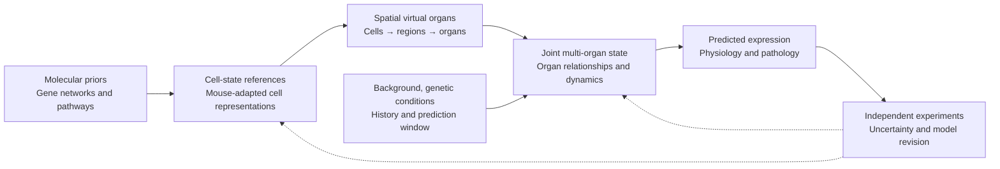

# PVMouse 3.0

### Design and Development Path for a Biological World Model

**Multiscale Modeling and Intervention Prediction, Starting with a Virtual Mouse**

[Read the white paper](PVMouse-3.0-White-Paper.pdf) · [中文说明](README.zh-CN.md) · [Architecture](ARCHITECTURE.md) · [Development path](DEVELOPMENT.md) · [Reading guide](READING_GUIDE.md)

**Authors:** Dayuan Zou & Y. S.  
**Affiliation:** Nanjing Singularity Biotech Co., Ltd.  
**White paper:** November 2026 · 85 pages

## Overview

PVMouse 3.0 (Panoramic Virtual Mouse V3.0) is a proposed minimum viable product for a biological world model. It aims to connect molecular knowledge, cell states, spatial organ organization and inter-organ relationships within a shared biological state space, linking state estimation to intervention-response prediction and experimental feedback.

The initial scope is **C57BL/6J mice**, covering the **brain, heart, liver, skeletal muscle and spleen**. Development follows the principle: **first reconstruct normal states, then simulate deviations**.

> **Project status:** This repository publishes the white paper and companion documentation. The paper reports that some algorithmic components have been built and data cleaning is underway; the complete system remains to be completed and validated. This repository does not include executable model code, trained weights or research datasets. Capabilities described below are research objectives, not validated performance claims.

## The central research question

**Does adding cellular, spatial and multi-organ information improve predictions of molecular responses and functional outcomes under defined perturbations, compared with simpler alternatives?**

The proposed framework is organized around four capabilities:

- Estimate current biological states from available observations.
- Predict state changes and functional consequences over a defined time horizon.
- Compare responses to specified perturbations, with causal interpretations requiring suitable experimental designs and identification assumptions.
- Estimate uncertainty and identify observations or experiments that could improve the model.

## Proposed architecture



| Layer | Role |
| --- | --- |
| Molecular | Organize typed, evidence-traceable gene relationships, pathways and other molecular priors. |
| Cellular | Adapt existing cell representations to mouse tissues, ages and biological contexts. |
| Spatial organ | Combine cell states, composition and spatial organization into regional and organ states with observation readouts. |
| Multi-organ | Connect organ states, model genetic responses and temporal changes, and predict associated functional readouts. |

See [ARCHITECTURE.md](ARCHITECTURE.md) for interfaces, intended inputs and outputs, and validation principles.

## Initial MVP and evaluation

| Dimension | Initial scope |
| --- | --- |
| Genetic background | C57BL/6J, with background and experimental context recorded |
| Organs | Brain, heart, liver, skeletal muscle and spleen |
| First perturbation tasks | Single-gene knockouts and appropriate matched controls |
| Intended predictions | Multi-tissue transcriptomic responses, associated physiological/pathological readouts and changes over a defined period |
| Data relationship | Preserve pairing among tissues and functional measurements from the same animal |
| Development order | Reference components → brain spatial prototype → five organ modules → normal joint states → genetic responses and time |

Two tasks must be evaluated separately: **estimating missing observations** from available same-animal measurements, and **predicting intervention outcomes** using only information available at query time. Evaluation uses simple baselines, component ablations, animal-grouped splits, independent observations and calibrated uncertainty. Cross-sectional age references do not directly establish individual longitudinal trajectories.

## Reported starting resources

Section 8.1 reports the following collections **as of October 25, 2026**:

| Collection | Tissue samples reported |
| --- | ---: |
| C57BL/6J reference bulk RNA-seq collection, ages 1–116 weeks | 4,741 |
| Additional collection from genetic or other perturbations on the C57BL/6J background | 2,511 |
| Brain subset identified within those collections for the first spatial prototype | 775 |

These counts refer to **tissue samples, not individual animals**. The 775 brain samples are a subset, not an additional collection. These resources are described in the paper and are not distributed in this repository.

## Research applications and extensions

The paper discusses five prospective applications: exploring candidate-compound indications; comparing drug combinations and schedules; identifying multi-tissue risk signals; prioritizing therapeutic targets and modulation strategies; and identifying candidate pharmacodynamic and safety-monitoring measures.

Drug, dietary and environmental tasks require their own response data, treatment context, adaptation and independent validation. Additional organs, genetic backgrounds, observation modalities and eventual human applications are longer-term research directions. See [DEVELOPMENT.md](DEVELOPMENT.md).

## Read and navigate

- [White paper PDF](PVMouse-3.0-White-Paper.pdf): the complete source document, including figures and references.
- [Reading guide](READING_GUIDE.md): chapter topics and PDF page numbers.
- [Architecture](ARCHITECTURE.md): a concise technical companion.
- [Development path](DEVELOPMENT.md): stages, dependencies and evaluation objectives.
- [中文说明](README.zh-CN.md): Chinese-language overview.
- [Citation](CITATION.cff): machine-readable citation metadata.
- [Contributing](CONTRIBUTING.md): scientific discussion and collaboration guidance.
- [Rights and permissions](RIGHTS.md): current licensing status and author contacts.

Companion Markdown files summarize the attached white paper and are not a complete transcription. Refer to the PDF for the full argument, qualifications, equations and cited evidence.

## Citation

Zou, Dayuan, and Y. S. (2026). *PVMouse 3.0: Design and Development Path for a Biological World Model*. Nanjing Singularity Biotech Co., Ltd. November 2026. White paper.

```bibtex
@techreport{zou_ys_pvmouse_2026,
  author      = {Zou, Dayuan and {Y. S.}},
  title       = {{PVMouse 3.0}: Design and Development Path for a Biological World Model},
  institution = {Nanjing Singularity Biotech Co., Ltd.},
  year        = {2026},
  month       = nov,
  type        = {White paper},
  url         = {https://github.com/PVMouse3-0/PVMouse-3.0-White-Paper}
}
```

## Discussion and contact

Methodological feedback, data/model collaboration and joint experiments are welcome. Please use [GitHub Issues](https://github.com/PVMouse3-0/PVMouse-3.0-White-Paper/issues) for public discussion, following [CONTRIBUTING.md](CONTRIBUTING.md).

Author contacts listed in the paper: [dayuanz4005@outlook.com](mailto:dayuanz4005@outlook.com) · [syan0328@outlook.com](mailto:syan0328@outlook.com).

No open-source or open-content license is specified in this publication. See [RIGHTS.md](RIGHTS.md) for reuse inquiries.
